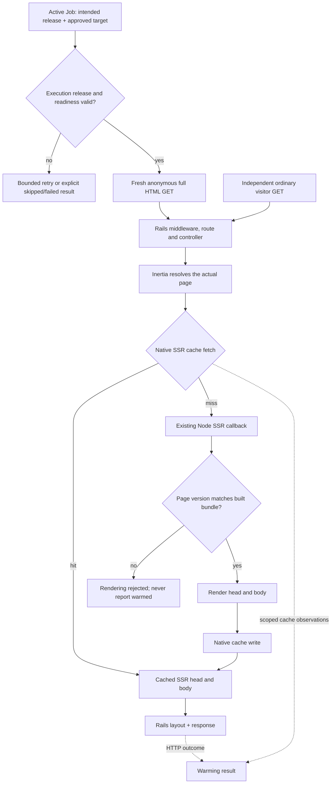

# Architectural grounding: Inertia SSR cache warming

This is the pre-implementation source investigation. [Architecture](architecture.md)
records the chosen design and implementation refinements.

Evidence date: October 12, 2026 (Pacific/Honolulu). This synthesizes three read-only investigations: a production warming system ShakaCode built earlier for a client application, the Inertia adapter, and React on Rails packaging. It explains existing behavior and the resulting design constraints; proposed package shapes are identified as proposals. It contains no copied proprietary implementation or business strategy.

## Overview

`inertia_rails_ssr_cache` should prepare the cache that the Rails Inertia adapter already uses when serving an initial HTML page. The adapter owns the page payload, SSR cache key, cache fetch and Node rendering request. The warmer's responsibility is to send approved anonymous requests through that normal path, schedule them with Active Job, check release compatibility, and report evidence that later requests can reuse the result. Building another SSR cache or reproducing Inertia's page serializer would add a second source of truth without improving warming.

That earlier production warming system demonstrates why useful warming requires more than dispatching GETs: queued work can run on an old release, a replica can be unready, parent jobs can finish before descendant work, and successful HTTP responses can hide rendering failures. Those lessons transfer; Sidekiq batches, infrastructure provisioning, application-specific route discovery and GQL LRU warming do not. The gem can provide a bounded portable starting point and leave queue capacity and deployment readiness to explicit host configuration.

## Key Concepts

| Concept           | Owner                                 | Meaning                                                                                                                                                                                                           |
| ----------------- | ------------------------------------- | ----------------------------------------------------------------------------------------------------------------------------------------------------------------------------------------------------------------- |
| Public target     | Host application                      | An explicitly approved GET path, origin and stable anonymous variant. The app controls eligibility; the gem does not discover authenticated or personalized pages.                                                |
| Inertia page      | Released Rails adapter                | Component, resolved props, full path, version and adapter metadata. This is the serialized input to SSR and its cache identity.                                                                                   |
| Native SSR entry  | Rails adapter/cache store             | Cached `{head, body}` from Node. The key derives from the exact serialized page. It is not the entire Rails HTTP response.                                                                                        |
| Release identity  | Host deployment/build                 | An immutable value that aligns Rails request generation, page/cache version and the actual Node bundle. Commit identity alone need not uniquely identify a deployment.                                            |
| Warming operation | Proposed gem                          | Executes a vetted target in a fresh request context, captures scoped cache evidence and returns an honest result.                                                                                                 |
| Warming job       | Active Job plus proposed gem          | Carries intended release and target data, rechecks eligibility/readiness at execution, and runs bounded work. Portable scheduling does not imply distributed exactly-once execution or global concurrency limits. |
| Render guard      | Proposed npm package                  | A small wrapper around the existing Node render callback that rejects mismatched page/build identity before rendering. It owns neither an HTTP server nor a cache.                                                |
| Warm evidence     | Native cache + representative visitor | An observed SSR cache hit on a subsequent independent request, correct SSR output, and no additional Node render. A completed job or HTTP 200 is weaker evidence.                                                 |

## How It Works

### The serving path already defines correctness

The tested source baseline is released `inertia_rails` **3.22.0**, tag commit `d440918e2455b805f25669ccc3973a81f91d9801`. A controller assembles its data and shared props, then calls `render inertia:`. `InertiaRails::Renderer` binds configuration to that controller and chooses a full HTML or JSON response. The presence of any `X-Inertia` header selects the JSON branch; warming must omit that header and other partial-visit headers.

On a full HTML request, the adapter resolves the page and passes it to `InertiaRails::SSRRenderer`. When SSR and its cache are enabled, the native key is `inertia_ssr/` plus the MD5 of `page.to_json`; the adapter calls `InertiaRails.cache_store.fetch`. A miss POSTs the page to Node and stores its parsed `{head, body}` response. Rails then combines the SSR result with its layout. Controller work and prop resolution have already happened before this cache lookup, so a hit does not inherently avoid SQL or prop construction. [Released Renderer](https://github.com/inertiajs/inertia-rails/blob/d440918e2455b805f25669ccc3973a81f91d9801/lib/inertia_rails/renderer.rb), [released SSRRenderer](https://github.com/inertiajs/inertia-rails/blob/d440918e2455b805f25669ccc3973a81f91d9801/lib/inertia_rails/ssr_renderer.rb).

The optional guard sits inside the callback boundary before application rendering; the diagram groups it with the existing server to show ownership. No new cache-writing API is required.

### The transport must preserve the same inputs

Two structurally different transport designs remain viable for the architecture comparison. An **in-process Rack request** invokes the configured Rails application from the job process, preserving ordinary middleware/controllers while avoiding a load balancer sending requests to a different Rails release. A **release-pinned HTTP request** reaches a separately running application instance and avoids in-process reentrancy, but needs trusted in-application cache evidence as well as stable routing. A successful public HTTP response cannot establish which cache was populated.

Both designs must create a fresh anonymous context for each target. Cookies from one target must never carry into another. Host, locale and device variants must be explicit; paths preserve meaningful query strings. Do not inject authentication, bypass controller authorization, strip personalized props, silently follow redirects, or weaken middleware to increase the apparent hit rate. The historical warmer used special environments and application-specific layout choices; those are not portable defaults.

The URL is only part of the cache identity. Session props, timestamps, flash, generated identifiers and other changing page values can defeat reuse. Conversely, host or headers not represented in page JSON do not independently vary the native key. The invariant is that identical serialized page inputs must produce identical SSR output. A Node renderer that reads tenant or locale from unrelated ambient state violates that contract. The gem should surface unstable/unverifiable targets rather than normalize page JSON or guess keys.

### Release safeguards belong at execution, not only enqueue

A warming job should carry its intended release identity and recheck it immediately before rendering. Rolling deployments can leave old workers consuming new jobs; the earlier system needed a central descendant-job guard after starter-only checks proved insufficient. Readiness checks must be bounded and fresh, with a terminal result when attempts expire. The host knows whether migrations, replicas, workers and SSR artifacts are ready; the gem should not infer those facts from one process or deploy platform.

The same build identity should participate in the adapter's configured page version. That version is already serialized into native cache input, allowing old/new releases and rollback entries to coexist without reproducing keys. It still does not prove the Node service has matching code: a new Rails process can send a new version to an old Node bundle. Pinning the SSR origin or checking an embedded build identity inside the callback closes that gap. Native Node `/health` is not bundle proof. [Asset versioning](https://inertia-rails.dev/guide/asset-versioning), [Node SSR server source investigated](https://github.com/inertiajs/inertia/blob/c9092cdec38336bfdb11209f5878f472aa4e873e/packages/core/src/server.ts).

Commit and deployment identities should remain distinct when needed: redeploying or rolling back the same commit can legitimately require warming again. A historical “completed” marker also cannot prove entries still exist after expiry or eviction. Do not implement permanent deduplication from that marker. Start with a bounded job/run model; if later fan-out needs aggregate completion or cancellation, test the actual terminal semantics and require backend capabilities explicitly.

### Evidence must separate attempted warming from reusable cache

Released 3.22.0 can return HTTP 200 after SSR is disabled, a bundle is missing, or a handled rendering error falls back to client rendering. Its released renderer does not emit the newer `ssr.inertia_rails`/render instrumentation found on development master. The implementation must therefore use released behavior and ordinary Active Support cache notifications, scoped to the operation, rather than requiring an unreleased notification by version number.

The decisive integration proof uses the actual released adapter and a minimal application. Warm a stable anonymous target, then issue a separate representative visitor request. Require an observed native SSR cache hit, correct SSR body/head and no increment in Node render count. Add negative cases for disabled cache, NullStore, failed writes, unstable props, SSR failure, mismatched build, redirects and authenticated-only routes. Scope observations so another thread's cache event cannot be credited to this operation. [Active Support instrumentation](https://guides.rubyonrails.org/active_support_instrumentation.html).

A worker-local MemoryStore can pass a same-process unit test while the web process remains cold. Production usefulness requires a shared cache or a clearly documented same-process deployment. Proof should distinguish “already hit,” “generated and subsequently reused,” and “not verified,” without claiming an HTTP success establishes warmth. The Rails cache API is the boundary; the gem must not write entries directly. [Rails Cache Store API](https://api.rubyonrails.org/classes/ActiveSupport/Cache/Store.html).

### Package structure should reinforce these boundaries

React on Rails provides useful packaging conventions: a private pnpm workspace root, an ESM npm package built with TypeScript, deliberate exports/files, a gem with an isolated version file, and coordinated Ruby/npm versions. A single new gem can use a root Gemfile/gemspec rather than copying the larger repository's multiple bundles. The proposed npm guard can remain a small callback wrapper with no React, Sidekiq or cache-server runtime dependency unless the verified API requires one. [Pinned RoR root manifest](https://github.com/shakacode/react_on_rails/blob/7a7b62656d1a9f6857b7581aabd223d54489b480/package.json), [package manifest](https://github.com/shakacode/react_on_rails/blob/7a7b62656d1a9f6857b7581aabd223d54489b480/packages/react-on-rails/package.json).

Use shared Shaka conventions with real blocking checks: RuboCop/performance/RSpec, RBS plus Steep implementation checking, strict TypeScript and typed ESLint, Prettier, Knip, package linting, dependency audits, actionlint and workflow security analysis. Keep compiler/linter suppressions narrow and documented. RoR's current Steep invocation is disabled in CI, so copying that workflow would not satisfy the clean project's strictness goal. Build and inspect both package artifacts; a clean consumer must be able to load their public entry points. [RoR lint CI](https://github.com/shakacode/react_on_rails/blob/7a7b62656d1a9f6857b7581aabd223d54489b480/.github/workflows/lint-js-and-ruby.yml), [Steep](https://github.com/soutaro/steep), [typed ESLint](https://typescript-eslint.io/getting-started/typed-linting/), [publint](https://publint.dev/docs/).

Keep private research outside distributable allowlists. Private repository visibility does not stop accidental registry publication; npm's `private: true` does. Gem private-host restrictions require an actual chosen registry. Initial CI can build and verify artifacts without a publishing workflow. [npm package manifest](https://docs.npmjs.com/cli/v11/configuring-npm/package-json/), [RubyGems publishing](https://guides.rubygems.org/publishing/).

## Where Things Live

| System                                      | Files to start with                                                                                                                                                                                      |
| ------------------------------------------- | -------------------------------------------------------------------------------------------------------------------------------------------------------------------------------------------------------- |
| Released Inertia Rails request/SSR behavior | `lib/inertia_rails/renderer.rb`, `lib/inertia_rails/ssr_renderer.rb` at v3.22.0. Configuration and request-extension source require release-specific verification when implementing.                     |
| Inertia JS callback contract                | `packages/core/src/server.ts`, `packages/react/src/createInertiaApp.ts`; inspected development commit `c9092cde...`. Validate a released JS package before declaring compatibility.                      |
| Historical operational lessons              | Summarized above; the earlier system's source is private and is not cited.                                                                                                                               |
| RoR packaging/tooling pattern               | Root `package.json`, `.rubocop.yml`, `eslint.config.ts`; `packages/react-on-rails/package.json`; `react_on_rails/react_on_rails.gemspec`; `.github/workflows/lint-js-and-ruby.yml`, pinned above.        |
| Proposed Ruby package                       | Root gemspec/Gemfile; `lib/inertia_rails_ssr_cache/` for target, warming and job behavior; `sig/` and `spec/`; thin Rails boundary isolated from pure core. Exact class names belong to the next sketch. |
| Proposed npm package                        | `packages/inertia-rails-ssr-cache/src/` for the render guard and public types, generated `dist/`, package-specific README/license and artifact tests.                                                    |
| Cross-package proof                         | Minimal Rails/Node application plus shared release/response fixtures and consumer artifact smoke checks.                                                                                                 |

## Gotchas

- **Released and development APIs differ despite a matching version constant.** Rails adapter master still reports 3.22.0 while containing newer page shapes, notifications and timeout options. Use the tag and installed release in tests.
- **Serialized bytes determine identity.** Semantically equivalent JSON with different ordering can miss. Preserve adapter ownership; do not canonicalize or reconstruct its payload.
- **Namespace and entry version are different.** A per-fetch namespace replaces the store's namespace unless explicitly composed; an entry `version:` shares a physical key and can cause old/new processes to overwrite one another. Immutable page/build identity is simpler for coexistence.
- **A missing notification is ambiguous.** It can mean a cache hit, skipped SSR or no eligible request. Positive cache-hit evidence is needed.
- **A background job success is not distributed completion.** Active Job offers scheduling, while global concurrency, uniqueness and aggregate fan-out state depend on implementation/backend choices.
- **Anonymous does not automatically mean deterministic.** Session-derived shared props and generated values can keep changing the native key. Do not remove safety data to make a benchmark pass.
- **Do not inherit application-specific shortcuts.** Middleware bypasses, read-replica routing, deploy scaling and priority route discovery remain host concerns.
- **Tool configuration is not verification.** RBS syntax alone is not Steep; source type checking alone is not package correctness; configured audit jobs must actually run and fail on relevant findings.

Remaining design choices are the Rack versus release-pinned HTTP transport, the smallest useful bounded job/run interface, the tested Rails/Ruby and released Inertia JS matrix, and the npm guard's exact callback signature. No production benchmark, global concurrency guarantee or end-to-end working prototype has yet been established by this research.
